# 架构

## 一张图

```mermaid
flowchart TD
    browser[浏览器<br>React 前端] -->|HTTPS| caddy[Caddy<br>域名 证书 分流]
    caddy -->|静态文件| fe[前端打包产物]
    caddy -->|/api| api[FastAPI<br>接口 鉴权]
    api <--> pg[(PostgreSQL<br>目标 任务 步骤 审批)]
    api -->|投递任务| redis[(Redis<br>队列 进度通道)]
    beat[Celery beat<br>心跳] -->|定时投递| redis
    redis --> worker[Celery worker<br>智能体循环在这里跑]
    worker <--> pg
    worker -->|发布进度| redis
    redis -->|订阅进度| api
    api -.->|SSE 实时推送| browser
    worker --> gate{{审批闸门}}
    gate -->|放行| tools[工具：搜索 读网页]
    gate -->|问用户| pg
    worker --> llm[模型 API]
```

读法：浏览器只和 Caddy 说话。Caddy 把页面请求交给前端文件，把 `/api` 交给 FastAPI。FastAPI 不自己跑智能体，它把任务放进 Redis 队列就立刻返回。worker 取出任务，跑智能体循环，每一步写进数据库并往 Redis 发一条进度。FastAPI 订阅进度，用 SSE 推给浏览器。需要审批时，worker 把请求写进数据库后停下，等用户在网页上点了批准，再由新的任务接着跑。

## 智能体的七个模块落在哪

| 模块 | 落在仓库的哪里 | 靠哪项基础设施 |
| --- | --- | --- |
| 网关与入口 | `backend/app/api/client/v1/goals.py`，前端页面 | FastAPI |
| 智能体循环 | `backend/app/agent/loop.py`，由 Celery 任务调用 | Celery worker |
| 工具与技能 | `backend/app/agent/tools/`、`backend/app/agent/skills/` | 无 |
| 任务与状态 | `backend/app/models/` 里的 goal、task、step | PostgreSQL |
| 调度与主动性 | `backend/app/schedule/jobs/`、`celery_app.py` 的 beat 配置 | Celery beat、邮件 |
| 记忆与上下文 | `backend/app/agent/memory.py`、memories 表 | PostgreSQL |
| 权限与审批 | `backend/app/agent/guard.py`、approvals 表、审批页 | PostgreSQL |

## 和 OpenClaw、Muse 的对照

| 本项目 | OpenClaw | Muse |
| --- | --- | --- |
| FastAPI + 前端 | Gateway、Channels | 客户端直连虚拟机 |
| worker 里的循环 | Brain、Hands | Hatch 主程序 |
| tools、skills | Skills | 连接器 + 技能 |
| goals、tasks、steps 表 | 会话与命令队列 | Postgres 持久状态、目标页 |
| beat + 邮件 | Heartbeat、cron | 定时与事件触发的后台工作 |
| memories 表 + 记忆页 | Markdown 记忆 | 可编辑的记忆文件 |
| guard + approvals 表 + 审批页 | Exec Approval Manager | Sentinel、审批卡片 |

## 用你自己的话填（阶段 0 的作业）

合上资料，用口语写，每题三五句。写不出的地方就是还没懂的地方。

### 我在网页上点「新建目标」，到这条目标出现在列表里，中间经过了哪些东西？

（在这里写）

### 为什么 FastAPI 不直接跑智能体，而要交给 worker？

（在这里写）

### PostgreSQL 和 Redis 都能存东西，这个项目里它们各管什么？

（在这里写）

### 智能体跑了五步，网页是怎么一步步实时看到的？

（在这里写）

### 服务器重启之后，哪些东西还在，哪些没了？

（在这里写）
