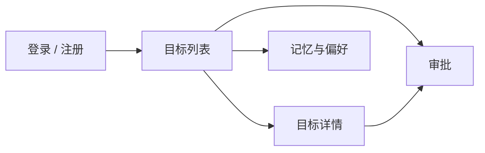

# 原型：五个页面

这是文字线框图，阶段 0 由你确认和修改。它参照 Muse 的三个界面设计：目标页、活动日志、审批卡片。先不考虑好看，只确定每页有什么、点了去哪。

## 页面流转



## 1. 登录 / 注册

```
+----------------------------------+
|            job-agent             |
|  邮箱  [______________________]  |
|  密码  [______________________]  |
|           [ 登录 ]               |
|        没有账号？去注册          |
+----------------------------------+
```

对应接口：脚手架已有的 auth 接口。

## 2. 目标列表（首页）

```
+------------------------------------------------------+
| job-agent        目标 | 审批(2) | 记忆        退出   |
+------------------------------------------------------+
| 给它一个目标：                                       |
| [ 调研一下 XX 公司的 AI 应用开发岗位________ ] [开始]|
|   ( ) 只做一次   ( ) 每天检查                        |
+------------------------------------------------------+
| 调研 XX 公司              运行中   第 3 步   2 分钟前 |
| 每天盯上海的 Agent 开发岗  已安排   下次 明天 9:00   |
| 调研 YY 公司              等待审批                   |
| 调研 ZZ 公司              已完成   报告              |
+------------------------------------------------------+
```

对应接口：`POST /goals`、`GET /goals`。阶段 1 只做新建和列表，状态列先全是「排队中」。

## 3. 目标详情

```
+------------------------------------------------------+
| < 返回      调研 XX 公司                  运行中     |
+------------------------------------------------------+
| 计划                                                 |
|  [x] 了解公司主营业务                                |
|  [>] 查在招的 AI 岗位和要求                          |
|  [ ] 汇总成报告                                      |
+------------------------------------------------------+
| 活动（实时）                                         |
|  10:02  搜索 「XX 公司 AI 应用 招聘」     0.8s       |
|  10:02  读网页 xx.com/careers             2.1s       |
|  10:03  思考中...                                    |
+------------------------------------------------------+
| 报告                                                 |
|  （完成后显示，每条结论带来源链接）                  |
+------------------------------------------------------+
| 本次花费：12 步，约 0.03 美元                        |
+------------------------------------------------------+
```

对应接口：`GET /goals/{id}`、`GET /goals/{id}/events`（SSE）。这一页是面试演示的重点。

## 4. 审批

```
+------------------------------------------------------+
| 待你批准                                             |
+------------------------------------------------------+
| 来自目标：调研 YY 公司                               |
| 它想做：发送邮件                                     |
| 收件人：hr@yy.com                                    |
| 内容预览：您好，我想咨询...                          |
| 为什么需要批准：这个动作发出后无法撤回               |
|                         [ 拒绝 ]   [ 批准 ]          |
+------------------------------------------------------+
| 最近的裁决记录                                       |
|  昨天 15:20  读网页 xx.com      自动放行             |
|  昨天 15:21  发送邮件           已拒绝               |
+------------------------------------------------------+
```

对应接口：`GET /approvals`、`POST /approvals/{id}/decision`。设计要点来自 Muse：审批用结构化卡片，写清楚到底要做什么，不混在对话里。

## 5. 记忆与偏好

```
+------------------------------------------------------+
| 求职偏好（每次任务都会带上）                         |
| [ 目标岗位：AI 应用开发 / Agent 开发            ]    |
| [ 目标城市：...                                 ]    |
| [ 一定不考虑：...                               ]    |
| 简历摘要                                             |
| [ ...                                           ]    |
|                                        [ 保存 ]      |
+------------------------------------------------------+
| 它自己记下的（可以删除）                             |
|  - XX 公司的岗位要求熟悉 FastAPI            [删除]   |
+------------------------------------------------------+
```

对应接口：`GET` / `PUT /memory`。

## 阶段 0 要你确认的三件事

1. 五个页面里，哪一个你觉得可以砍掉或合并？
2. 目标列表上，每条目标最需要一眼看到的是哪三个信息？
3. 用手机打开时，目标详情页的三块内容按什么顺序排？
